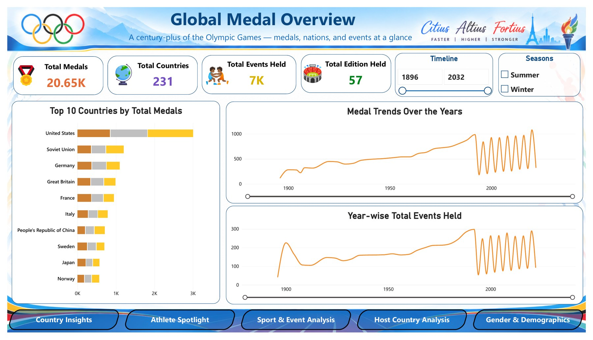
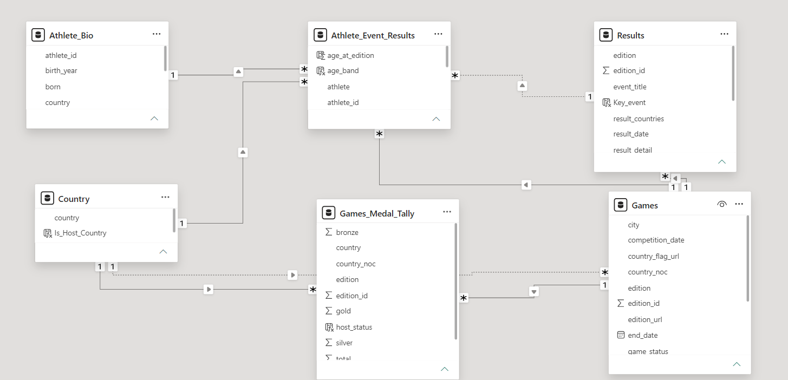
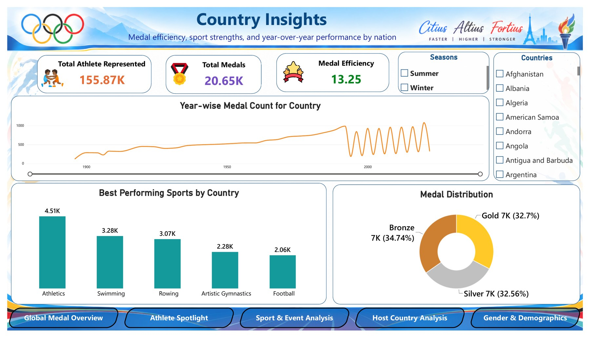
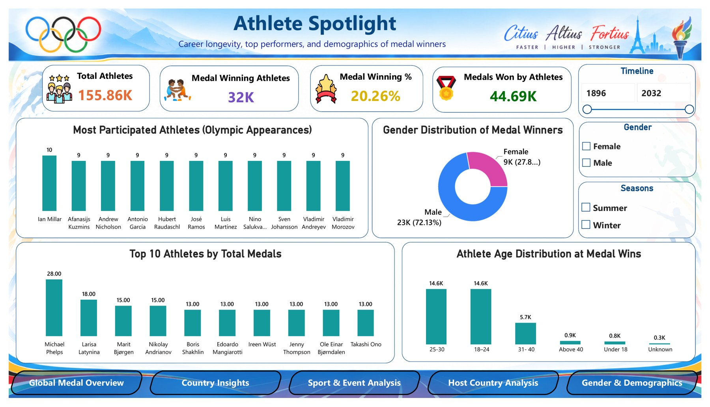
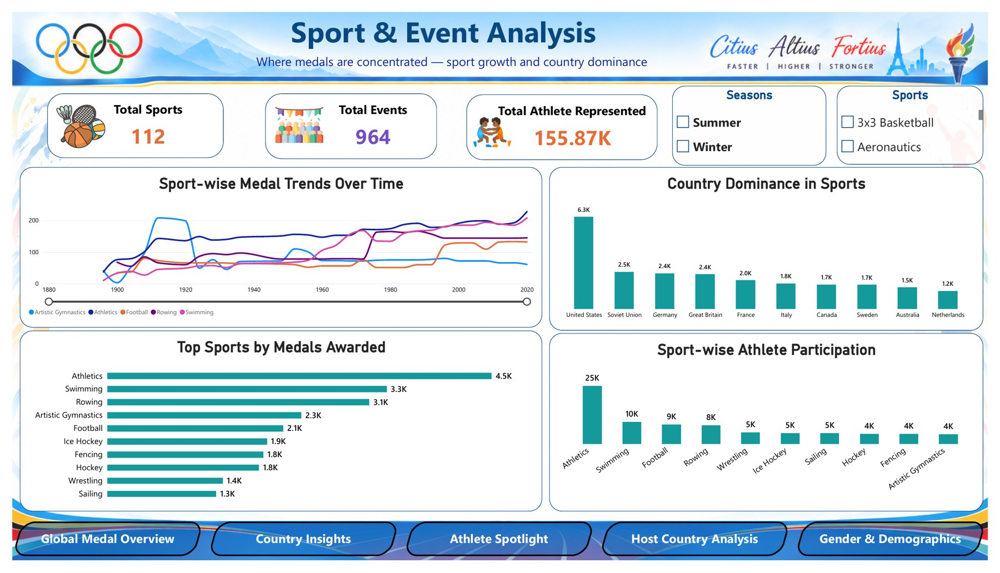
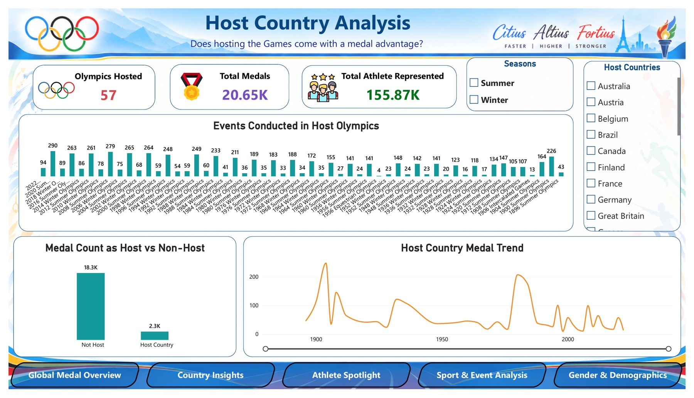
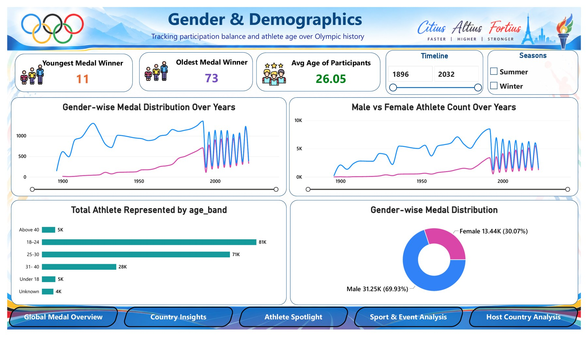

<h1 align="center">Olympic Games — Performance Insights Dashboard</h1>

<p align="center">
  
  
  
  
</p>

<p align="center">
  
</p>

## Overview

A fully interactive Power BI report built on historical Olympic Games data covering 57 editions, 231 countries, 112 sports and 155.87K athletes, answering the question: *which countries, sports and athletes drive Olympic success, and does hosting the Games bring a medal advantage?*

The report was built for the case study "Olympic Insights Using Data Analytics", in which the International Olympic Committee (IOC) asks for advanced insight into athlete performance, country-wise medal trends and sport-specific dominance. It spans six connected pages with navigation buttons:

- **Global Medal Overview** — total medals, top nations and long-run medal and event trends
- **Country Insights** — medal efficiency, best sports and medal split by country
- **Athlete Spotlight** — top medallists, career longevity and the age and gender profile of winners
- **Sport & Event Analysis** — where medals concentrate, sport growth and country dominance
- **Host Country Analysis** — host versus non-host medal performance across editions
- **Gender & Demographics** — participation balance and athlete age over Olympic history

## Business Problem

> The IOC wants advanced insights into athlete performance, country-wise medal trends and sport-specific dominance across the Olympic Games. Using historical Olympic data, build a six-page Power BI navigational dashboard with navigation buttons to track achievements, evaluate performance KPIs and forecast future outcomes for strategic planning and athlete development.

The original brief is available in [`images/Case_Study_Brief.jpg`](images/Case_Study_Brief.jpg).

## Key Metrics at a Glance

| Metric | Value |
|---|---|
| Total Medals | 20.65K |
| Athletes Represented | 155.87K |
| Countries | 231 |
| Sports / Events | 112 / 964 |
| Olympic Editions | 57 |
| Medal Efficiency (medals per 100 athletes) | 13.25 |
| Medal-Winning Athletes | 32K (20.26%) |
| Average Age of Participants | 26.05 |

*All KPIs are slicer-driven and recalculate live by Season, Timeline, Country, Sport, Gender and Host country.*

## Tech Stack

```
Microsoft Power BI
├── Power Query      → Data ingestion & cleaning (6 source tables)
├── Data Modelling   → Galaxy schema: 2 fact tables sharing dimension tables
├── DAX              → Total Medals, Total Athletes, Medal Efficiency, Medal Winning %,
│                      Avg Age, Host Medal Share + calculated columns
├── Slicers          → Season · Timeline · Country · Sport · Gender
└── Report Pages     → 6 pages with navigation buttons
```

## Data Model

<p align="center">
  
</p>

| Table | Type | Role |
|---|---|---|
| `Athlete_Event_Results` | Fact | Athlete participation by event and edition (`age_at_edition`, `age_band`) |
| `Games_Medal_Tally` | Fact | Gold, silver, bronze and total medals per country and edition (`host_status`) |
| `Athlete_Bio` | Dimension | One row per athlete (`athlete_id`, `birth_year`, `country`) |
| `Games` | Dimension | Edition details: host city, dates and status |
| `Results` | Dimension | Event results per edition (`Key_event`) |
| `Country` | Dimension | Country list with host flag (`Is_Host_Country`) |

Calculated columns: `age_band`, `Key_event`, `Is_Host_Country`, `host_status`. Dotted lines in the model view are inactive relationships, kept off to avoid ambiguous filter paths.

## Pages Inside the Dashboard

| Page | Purpose |
|---|---|
| Global Medal Overview | Benchmark scale: total medals, countries, events and editions; top 10 countries by medal colour; medal and event trends over time |
| Country Insights | Compare a country's medal output with its team size; medal efficiency, yearly medal count, best sports and gold/silver/bronze split |
| Athlete Spotlight | Medal-winning athletes and win rate; top 10 medallists, most Olympic appearances, age distribution at medal wins, gender of winners |
| Sport & Event Analysis | Sport-wise medal trends, top sports by medals, athlete participation and country dominance by sport |
| Host Country Analysis | Events per host Olympics, medals as host versus non-host and the host-country medal trend |
| Gender & Demographics | Youngest and oldest medal winners, male versus female participation and medals over time, athletes by age band |

### Dashboard Previews

| | |
|---|---|
|  |  |
|  |  |
|  |  |

## Key Insights

1. **Medal power is concentrated** — the United States leads with roughly 3K medals, about 2.5x the Soviet Union (~1.2K), and 5 sports (Athletics 4.51K, Swimming 3.28K, Rowing 3.07K, Artistic Gymnastics 2.28K, Football 2.06K) account for a large share of all medals.
2. **Summer and Winter Games differ sharply** — Summer editions reach about 1,000+ medals and up to 290 events, while Winter editions stay near 200–300 medals.
3. **A podium is rare, a legend rarer** — 32K of 155.86K athletes (20.26%) won a medal; Michael Phelps leads with 28, ahead of Larisa Latynina with 18.
4. **Peak performance falls between 18 and 30** — the 18–24 and 25–30 bands each hold 14.6K medal wins, about 79% of age-tagged wins.
5. **Hosting helps, but less than it used to** — host editions produced 2.3K of 20.65K medals (about 11%), with home spikes in the early 1900s and 1980s fading in recent editions.
6. **The gender gap is narrowing** — women won 13.44K medals (30.07%) versus 31.25K for men (69.93%), up from near zero before 1950.

## Key Recommendations

| # | Recommendation |
|---|---|
| 01 | **Back high-yield sports** — Gymnastics, Rowing and Swimming convert athletes into medals best; track medals-per-athlete as a development KPI |
| 02 | **Broaden the medal base** — support emerging National Olympic Committees in sports where medal efficiency is high |
| 03 | **Plan around the 18–30 window** — build talent pipelines that deliver peak athletes in their twenties while supporting long careers |
| 04 | **Keep growing women's participation** — targeted event additions can lift the 30% medal share further |
| 05 | **Treat hosting as an investment** — tie host bids to sport-specific preparation as the home advantage shrinks |
| 06 | **Track KPIs every edition** — keep this report as a standing scorecard for efficiency, win rate, host share and gender split |

*Next step: add forecasting (trend lines per country and sport) to cover the "forecast future outcomes" requirement of the brief.*

## How to Use

1. Clone or download this repository.
2. Open `Olympic_Insights_Dashboard.pbix` in Microsoft Power BI Desktop.
3. Navigate between the six report pages using the navigation buttons at the bottom of each page.
4. Use the slicers — Season, Timeline, Country, Sport and Gender — to filter the view.
5. All KPIs and visuals update automatically.

A full project presentation (problem statement, data model, approach, dashboards with insights and recommendations) is available in [`docs/`](docs/).

## Repository Structure

```
Olympic-Insights-Power-BI-Dashboard
├── Olympic_Insights_Dashboard.pbix      ← Main Power BI report
├── cover.jpg                            ← Dashboard cover screenshot
├── Olympic_Dashboards.pdf               ← All six dashboard pages (PDF export)
├── docs
│   └── Olympic_Insights_Presentation.pptx   ← Full project presentation
├── images
│   ├── 01_Global_Medal_Overview.jpg
│   ├── 02_Country_Insights.jpg
│   ├── 03_Athlete_Spotlight.jpg
│   ├── 04_Sport_and_Event_Analysis.jpg
│   ├── 05_Host_Country_Analysis.jpg
│   ├── 06_Gender_and_Demographics.jpg
│   ├── Data_Model.png
│   └── Case_Study_Brief.jpg
└── README.md
```

---

## About Me

**Yatharth Aphale**
Business Analyst

[](https://www.linkedin.com/in/yatharth-aphale-338b203b8)
[](https://github.com/Yatharth-2206)
[](mailto:aphaleyatharth@gmail.com)

*If this project was useful, a star on the repo is appreciated — feel free to reach out for feedback, questions, or opportunities.*
